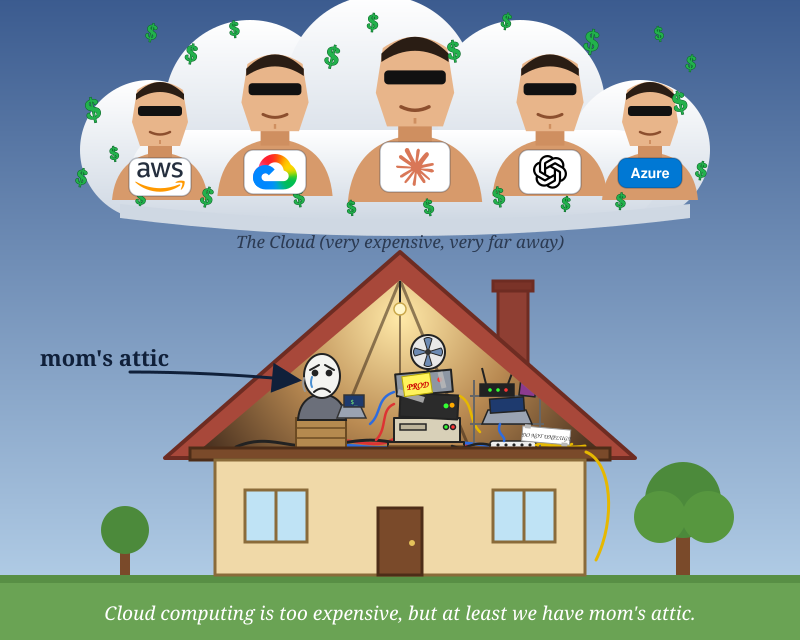

# Attic Cloud

> Cloud computing is too expensive, but at least we have mom's attic.



Attic Cloud (identifier: `attic`) is a small private cloud written in Go. It runs virtual machines and LLM agents on
hardware you already own, and exposes both to Claude and other MCP clients. Every component has its own README with
its API contract; this page is the map.

## Architecture

```
   clients: Claude / MCP clients, curl, SDKs, atticctl
        │ MCP (streamable HTTP)                │ Connect: gRPC, gRPC-Web or HTTP+JSON
        ▼                                      │
 ┌────────────┐   same bearer token            │
 │    mcp     │ ───────────────┬───────────────┤
 └────────────┘                ▼               ▼
                        ┌────────────┐   ┌────────────┐   service token (role "service")
                        │   agentd   │──▶│    vmd     │◀── ... agentd only ever acts as "service"
                        │ agents,    │   │ control    │
                        │ tasks, LLM │   │ plane      │
                        │ loop       │   └─────┬──────┘
                        └──┬──────┬──┘         │ node API (role "node")
                  Postgres │      │ Ollama     ▼
                  (agentd) │      ▼       ┌───────────┐   ┌───────────┐
                           ▼   models      │ vmd node  │   │ vmd node  │   one per VM host
                                           │ QEMU/KVM  │   │ QEMU/KVM  │
                                  Postgres │ guests    │   │ guests    │
                                  (vmd)    └───────────┘   └───────────┘
```

| Component | What it does | README |
| --- | --- | --- |
| vmd | VMs, disks, images, in-guest exec jobs, metrics, node placement. Runs as control plane, as a node, or both. | [services/vmd](services/vmd/README.md) |
| agentd | LLM agents, each tied to one VM; runs tasks as a model-driven loop over a `bash` tool, with guards and an objective check. | [services/agentd](services/agentd/README.md) |
| mcp | MCP server (20 tools) over vmd and agentd for Claude and other MCP clients. | [services/mcp](services/mcp/README.md) |
| libs/qemu | The node side: QEMU driver, disks and images, guest firewall lock-down, in-guest command and metrics scripts. | [libs/qemu](libs/qemu/README.md) |
| libs/authz | Tokens, roles, project bindings, revocation, Connect interceptors. | [libs/authz](libs/authz/README.md) |
| libs/common, libs/server | Error vocabulary, ids, Postgres and migrations; HTTP daemon, logging, metrics. | [common](libs/common/README.md), [server](libs/server/README.md) |
| api | The `.proto` files (source of truth) and the generated Go code. | [api](api/README.md) |
| cmd/atticctl | Admin CLI: keys, tokens, roles. | [cmd/atticctl](cmd/atticctl/README.md) |
| e2e | End-to-end tests over the real HTTP handlers. | [e2e](e2e/README.md) |
| deploy | Dockerfiles, the compose stack, production-style deployment notes. | [deploy](deploy/README.md) |

How the pieces work together:

- **Everything belongs to a project.** Every call carries an Ed25519-signed bearer token whose bindings say which roles
  it has in which projects. Servers hold only public keys, so a server cannot mint tokens. A caller with no binding on
  a project cannot even learn that its resources exist.
- **State lives in Postgres, work is leased.** vmd and agentd are stateless replicas. A reconciler (vmd) and a task
  runner (agentd) claim work with leases, so a crashed replica's work is picked up by another. Each service has its own
  database. See [ADR 2](docs/adr/0002-state-and-leases.md).
- **vmd drives nodes towards the state you ask for.** You set a VM's desired power state; the reconciler places it on a
  node that has capacity, starts QEMU through the node daemon, and records why when something is not as requested.
- **Commands run inside the guest.** An exec job is a directory in the VM, not a process held by a server, so jobs and
  their output survive restarts of every Attic component. See [ADR 3](docs/adr/0003-jobs-live-in-the-guest.md).
- **Agents are guarded.** A task ends `succeeded` only when your `check_command` passes (otherwise a claimed success is
  `succeeded_unverified`). Malformed tool calls are repaired or sent back to the model, runaway or repeating output is
  cut off, and a wall-clock limit applies. See [ADR 4](docs/adr/0004-agent-loop-guards.md).
- **Isolation.** Guests run as an unprivileged user and are firewalled from private networks; the node container needs
  `/dev/kvm` and `NET_ADMIN` only inside its own network namespace.

Scaling and failure, in short:

- **Scale-out:** run more vmd or agentd replicas on the same database. Projects can be sharded over several Postgres
  databases (`--postgres-dsn` more than once; the set is part of your data layout). A VM runs on the node that holds its
  boot disk, and there is no live migration.
- **A replica dies:** its leases expire after 30 seconds and another replica takes over. A running task resumes from its
  stored messages, and a command still running in the guest is found again, not started twice.
- **A node daemon or vmd restarts:** guests keep running (QEMU is detached) and are re-adopted. If a guest's QEMU
  crashes, the reconciler restarts it with backoff.
- **Postgres is down:** `/readyz` fails and API calls that need the database error out; running guests keep running.
- **Limits:** two vmd replicas can overcommit one node (the placement lock is per process), there is no cross-node image
  replication, and changing the shard set needs a manual migration.

All decisions are recorded in [docs/adr](docs/adr/). A proposal for a graph-based identity service is in
[docs/design/auth-graph.md](docs/design/auth-graph.md); it is not implemented.

## Quick start (Docker)

Requirements: Linux with KVM (`/dev/kvm`), Docker with Compose v2, Go (to run `atticctl`), about 3 GB of free disk and
a few GB of RAM for one small guest. Verified with Docker 29 on Linux. Run these from the repository root.

```bash
# 1. Signing keys: one pair per signer. Private keys stay in deploy/keys (gitignored).
for id in admin agentd vmd; do go run ./cmd/atticctl key generate -out deploy/keys -id "$id"; done

# 2. Settings: a database password, and the uid that may read the private keys.
printf 'ATTIC_POSTGRES_PASSWORD=%s\nATTIC_UID=%s\nATTIC_GID=%s\n' \
  "$(head -c16 /dev/urandom | od -An -tx1 | tr -d ' \n')" "$(id -u)" "$(id -g)" > deploy/.env

# 3. A guest image (Debian cloud image, about 350 MB) for the node to boot VMs from.
mkdir -p deploy/images
curl -L -o deploy/images/debian12.qcow2 \
  https://cloud.debian.org/images/cloud/bookworm/latest/debian-12-genericcloud-amd64.qcow2

# 4. Build and start: postgres, vmd (control plane), node (QEMU/KVM), agentd, mcp.
cd deploy && docker compose up -d --build && cd ..
```

The APIs listen on loopback only: vmd `127.0.0.1:8080`, agentd `127.0.0.1:8081`, MCP `127.0.0.1:8082`. Try it:

```bash
TOKEN=$(go run ./cmd/atticctl token mint -key deploy/keys/admin.key -kid admin \
  -sub user:me -type user -bind '*:admin' -bind '*:operator' -ttl 12h)
call() { curl -sS -X POST "http://127.0.0.1:8080/attic.vmd.v1.$1" \
  -H "Authorization: Bearer $TOKEN" -H 'Content-Type: application/json' -d "$2"; echo; }

call ImageService/RegisterImage '{"projectId":"","name":"debian12","nodeId":"node1","path":"/images/debian12.qcow2"}'
call ImageService/ListImages '{"projectId":"demo"}'          # wait for IMAGE_STATE_READY and copy the image id
call VMService/CreateVM '{"projectId":"demo","name":"vm1","cpus":1,"memoryMb":1024,"imageId":"IMAGE_ID","diskSizeGb":6,"start":true}'
call VMService/GetVM '{"id":"VM_ID","waitForState":"VM_STATE_PENDING","waitSeconds":30}'   # until VM_STATE_RUNNING
call ExecService/StartJob '{"vmId":"VM_ID","command":"uname -a","waitSeconds":20}'          # stdout is base64
```

To use Claude or another MCP client, point it at `http://127.0.0.1:8082/mcp` with the same `Authorization: Bearer`
header (put TLS in front of it for anything but loopback). For LLM agents add a model server and pull a model:

```bash
cd deploy && docker compose --profile llm up -d && docker compose exec ollama ollama pull qwen3:0.6b
```

That Ollama runs on the CPU. For a GPU, or to run several nodes, put TLS in front, change ports or run next to other
Docker projects, see [deploy/README.md](deploy/README.md). Stop everything with `docker compose down` (add `-v` to
delete the data volumes).

## Status

- Verified end to end in an isolated compose project: a real KVM guest booted inside the node container, command
  execution, metrics, file transfer, the guest firewall, the MCP tools and an agent task driven by a small model on the
  CPU. Unit, store-conformance and end-to-end tests run under `-race` (`make test`).
- Not yet exercised: the GitHub Actions workflow, GPU inference through the compose stack, multi-node placement on real
  hosts, and the sharded Postgres layout outside tests.
- Known limits are listed in the component READMEs (for example in [vmd](services/vmd/README.md) and
  [agentd](services/agentd/README.md)).

## Repository layout

Go workspace (`go.work`), one module per directory, no root module. The layering rule (which module may import which)
is enforced by `make boundaries`; see [CONTRIBUTING.md](CONTRIBUTING.md).

```
api/            proto sources and generated code        services/vmd/     VM service and node daemon
libs/common/    errors, ids, Postgres                   services/agentd/  agent service
libs/authz/     tokens, roles, interceptors             services/mcp/     MCP server
libs/qemu/      node driver and guest scripts           cmd/atticctl/     admin CLI
libs/server/    HTTP daemon, logging, metrics           e2e/              end-to-end tests
deploy/         Dockerfiles and compose stack           docs/             ADRs and design proposals
```

## Roadmap

Planned work and known gaps are in [TODO.md](TODO.md).

## Contributing

Build, test, conventions and the rules for what may be committed (this repository is public: no secrets, deployment
details or binaries) are in [CONTRIBUTING.md](CONTRIBUTING.md). Quick commands: `make build`, `make test`, `make vet`,
`make boundaries`.
