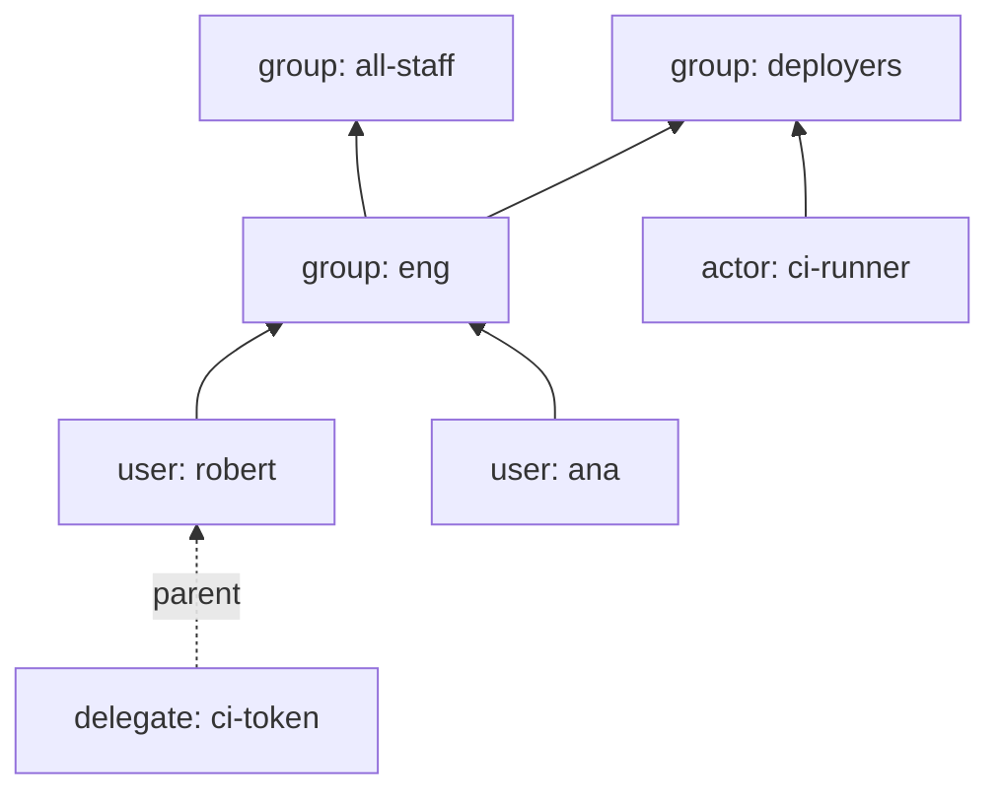
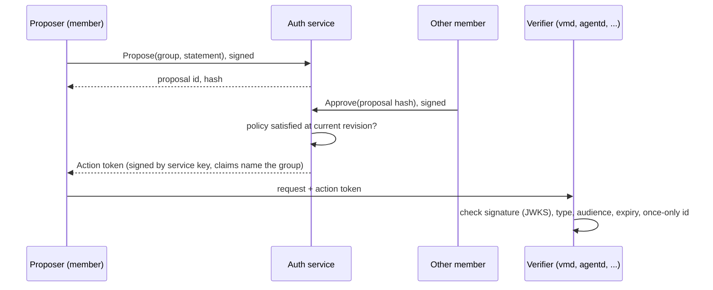

# Design: graph-based identity and authorization (`services/auth`)

Status: **proposal, not implemented.** This replaces the "planned identity service" note that the central auth documentation carried; the current token and role model is in [libs/authz](../../libs/authz/README.md).
Nothing here changes the running system until the phases in [Rollout](#rollout) are done.

## Summary

Everything is a **node**. Nodes are connected by one relation, **membership** ("A is a member of group G").
The service's main job is to answer one question quickly and consistently: *is node N a member of group G?*

Two rules keep the rest small:

1. **Identity is a key.** Every node that can act has an Ed25519 key. Whoever holds the key is that node.
2. **Authority is a statement, and a statement is either signed by one key or attested by one group.**
   A group attests a statement only after its policy is satisfied (for example two members approve it).
   Every change to the graph, and every "this action is allowed" token, is one such statement.

There is no separate role system, no ACL table and no per-service user table. Roles, project access and
approvals are all groups.

## Contents

- [Concepts](#concepts)
- [Graph model](#graph-model)
- [Membership check](#membership-check)
- [Time and expiry](#time-and-expiry)
- [Keys and proving identity](#keys-and-proving-identity)
- [Statements, actions and group policies](#statements-actions-and-group-policies)
- [Ownership](#ownership)
- [Delegation: sub-nodes](#delegation-sub-nodes)
- [How services use it](#how-services-use-it)
- [Storage and scaling](#storage-and-scaling)
- [API surface](#api-surface)
- [Security properties and threats](#security-properties-and-threats)
- [Bootstrapping](#bootstrapping)
- [Mapping from today's RBAC](#mapping-from-todays-rbac)
- [Rollout](#rollout)
- [Future: OIDC sign-in](#future-oidc-sign-in)
- [Open questions](#open-questions)

## Concepts

| Term | Meaning |
| --- | --- |
| **Node** | The only entity. Has an id, a `kind`, a name and a state (`active` / `disabled`). |
| **Kind** | `user` (a person), `actor` (a VM, agent or robot), `group`, `delegate` (a restricted sub-node). |
| **Membership edge** | `child → group`, with an optional expiry. The child is a node (any kind except `delegate`) or another group. |
| **Key** | Ed25519 public key of a `user`, `actor` or `delegate`. Proves "I am this node". |
| **Statement** | A canonical, versioned message such as "add `usr_a` to `grp_x`" or "VM `web` may be created in project `p`". |
| **Action** | A statement that has been authorized: signed by one node key, or attested by a group after its policy passed. |
| **Policy** | A group's rule for attesting: how many of its members must approve. |
| **Owner** | The node whose action is required to change a group. |
| **Expiry** | An optional time after which a membership edge, or a node, stops counting. Always evaluated against the clock, never needing a write to take effect. |
| **Revision** | A global, increasing counter. Every graph change gets one. Used for consistent reads and audit. |

## Graph model



Solid arrows are membership ("is a member of"). The dotted arrow is the delegation link (see below).
Membership is transitive: `robert → eng → all-staff` makes robert a member of `all-staff`.

Rules enforced on every write:

- **No cycles.** Adding `child → group` is refused if `group` is already a member (transitively) of `child`.
- **Only groups have members.** Users, actors and delegates are leaves.
- **Depth limit** (default 16). Bounds worst-case checks.
- **Names** are unique per kind, ids are opaque (`usr_…`, `act_…`, `grp_…`, `dlg_…`).
- **Expiry.** An edge may carry `expires_at`. An `actor` node may carry one too (a short-lived VM or job), and a
  `delegate` must (see [Time and expiry](#time-and-expiry)).
- **Disabling** a node makes every check about it false and stops it from authenticating. It is how to evict someone
  immediately, without waiting to edit every edge.

## Membership check

```
Check(subject, group, at_least_revision?) → { member: bool, revision: int, valid_until: time? }
```

Semantics for a normal node: true if there is a path of membership edges from `subject` to `group`, and the subject and
every group on the path are `active`, and no edge or node on the path has expired. `valid_until` is the time the
answer stops being true if nothing else changes, and is absent when it does not expire. Callers may cache a positive
answer until then.

Semantics for a `delegate` are in [Delegation](#delegation-sub-nodes).

Consistency: every response carries the revision it was computed at. A caller that just changed the graph passes that
revision as `at_least_revision` and gets an answer at least that fresh (read-your-writes). Callers that pass nothing get
the replica's current state, which is bounded-stale (target: under 1 s).

Implementation phases are in [Storage and scaling](#storage-and-scaling). The API does not change between them.

## Time and expiry

Some access should end by itself: an on-call rota for a week, a contractor for a month, a CI job for an hour.

**What can expire**

| Thing | Rule |
| --- | --- |
| Membership edge | Optional `expires_at`. After it, the edge does not exist for any check. |
| `actor` node | Optional `expires_at` (for example a VM created for a task). After it the node is disabled. |
| `delegate` node | Mandatory `not_after`, at most 30 days. |
| Proposal | Always expires (default 24 h). |
| Session and action tokens | Always expire (minutes). |

**Rules**

- **Time is read at check time.** Nothing has to run for an expiry to take effect, so a stalled worker can never leave
  access open. The service uses its own clock with no leeway for memberships. Token verification keeps the 30 s leeway.
- **Along a path, the earliest expiry wins.** `robert → eng` expiring Friday and `eng → all-staff` never expiring means
  robert's `all-staff` membership ends Friday. With several paths, the latest of the paths' earliest expiries counts.
- **No start times.** There is only `expires_at`, not `not_before`. A start and an end per edge make the validity of a
  multi-path membership a set of intervals, which cannot be summarised in one value and complicates caches and the
  closure index. A future grant is made as a later statement instead.
- **Extending** an expiry or making an edge permanent is a normal group mutation, authorized by the owner. Shortening
  and removing are the same.
- **Tokens never outlive the access they describe.** An issued token's `exp` is capped at the earliest `valid_until` of
  anything it relies on, and an action token's `exp` is capped at the earliest expiry among its approvers' memberships.
- **Policies count only live members.** An expired member is not eligible and an approval from one no longer counts
  (policy is evaluated at mint time, already the rule).
- **Housekeeping, not correctness.** A sweeper appends an `expired` entry to the changelog when an edge or node passes
  its time. That gives `Watch` consumers and the audit log an explicit event and lets the closure index drop the row.
  If the sweeper is late, checks are still correct.
- **History.** Expired edges are kept, as removed ones are. An audit query can ask "was N a member of G at time T" with an
  `at_time` argument (phase 6). Live checks always use now.

## Keys and proving identity

- Every `user`, `actor` and `delegate` has one or more keys, each with an id and a validity window.
- **Private keys never reach the service** for users and actors. A user keeps theirs in a passkey, hardware token or
  ssh-agent. A VM gets one at provisioning.
- Groups have **no key of their own**. A group's attestations are signed by the auth service's signing key
  (see [Statements](#statements-actions-and-group-policies)), with the group named in the claims.

Proving identity, two ways:

1. **Session token (default).** The node signs a server challenge. The service checks the key and returns a short-lived
   token (default 10 minutes) with the node id and revision. Services verify it offline against the JWKS.
2. **Per-request signature** for callers that cannot hold a session. The request carries a signature over a
   domain-separated hash of method, body, time and audience. Services call `Check` for the signer.

Key changes (rotation, loss) are statements:

- Rotation: signed by the current key.
- Recovery: attested by the node's recovery group (default for a user: `recovery`, a small group needing 2 approvals).

## Statements, actions and group policies

### Statement

A canonical message with a type, parameters, audience and expiry. Encoding is deterministic protobuf. Every signature
is over `"attic-auth/v1/" + purpose + 0x00 + bytes` so a signature for one purpose can never be replayed as another.

### Who can authorize a statement

| Authorizer | How | Meaning |
| --- | --- | --- |
| A `user` or `actor` node | signs it with its key | "this node says so". One key is enough. |
| A `group` | members propose and approve until the policy passes; the service then signs an **action token** | "the group says so". |

This is the whole authority model. A single person with direct authority is just a user node signing. Anything that
should need more than one person is a group.

### Group policy

Each group has exactly **one action type** (a string such as `auth.admin` or `vmd.deploy:prod`) fixed at creation, and
one policy. The group can only attest statements whose type is its action type.

| Policy | Passes when |
| --- | --- |
| `count(k)` | at least `k` distinct eligible members have approved. `k` is any integer from 1 up. |
| `percent(p)` | approvals from distinct eligible members are at least `p` percent of all eligible members (rounded up, minimum 1 approval). `p` is 1 to 100. |

Each group sets exactly one of these, and the owner can change it. "Majority" is `percent(51)`, "everyone" is
`percent(100)`. Single-approver groups (`count(1)`) are allowed on purpose: they are useful for rotas and
on-call pools. A group whose policy needs more approvals than it has eligible members can never mint, and the
service refuses to create or edit a group into that state (it can still become that way later when members leave).
Details that remove ambiguity:

- **Eligible members** are the leaf nodes (`user`, and `actor` if the group allows it) reachable through the group.
  A person who is in two subgroups counts once.
- Policy is evaluated **at mint time** against the live graph. A member removed after approving no longer counts, and a
  group with too few eligible members for its policy cannot mint until members are added.
- An approval is a signature over the proposal hash, so it cannot be moved to another statement.
- Proposals expire (default 24 h). An approval can be withdrawn until the action is minted.
- The group's `voters` setting is `users` (default) or `all`. Robots do not approve by default.

### Flow



### Action token

A JWT signed by the service (EdDSA, short life, default 5 min) with claims:

| Claim | Meaning |
| --- | --- |
| `grp` | the group that attested |
| `typ` | the group's action type |
| `stm` | hash of the statement (and the statement itself, if small) |
| `aud` | who may accept it |
| `apr` | ids of the approving nodes (for audit) |
| `rev` | graph revision the policy was evaluated at |
| `jti`, `iat`, `exp` | id, issue and expiry times |

Verifiers that want stronger assurance can also fetch the proposal and verify each approver's signature themselves
(see [threats](#security-properties-and-threats)).

## Ownership

Every group has one **owner**, a `user`, `actor` or `group`. Ownership is not recursive and not inherited: a change to
group `G` needs exactly one authorization, from `owner(G)`.

- Changes to `G` (add or remove a member, change policy, change owner, disable, delete) are statements of type
  `auth.admin/mutate`, with the exact operation and the expected revision in the parameters.
- If the owner is a user or actor: that node signs the statement.
- If the owner is a group `O`: `O` must attest it, which means `O`'s action type must be `auth.admin`.

That last rule is deliberate: **a group that approves deployments cannot also administer groups.** Separation of duties is
enforced by the type system instead of by convention. Admin groups own other groups and have `auth.admin`. Deploy
groups have `vmd.deploy:...` and own nothing.

Owner cycles are harmless. Ownership is one step, so `G` owned by `O` owned by `G` just means they administer each
other. A group may own itself, which is how the root group works.

## Delegation: sub-nodes

A node can mint a **delegate**: a child node with its own key that can stand in for a *subset* of the parent's
memberships, and nothing else. The parent hands the key to a third party (a CI job, a contractor, a script).

A delegate has:

- `parent`: the node it acts for (a user, actor or another delegate).
- `scope`: a set of groups `S` the parent chose, and optionally a `vote` list: groups whose proposals the delegate may
  approve on the parent's behalf (see below).
- `not_after`: mandatory expiry (default 1 h, maximum 30 days). The delegate also ends when the parent's own access to
  the scoped groups ends, whichever is earlier; the parent's expiries propagate automatically because the check reads
  the parent live.
- optional `audience`: the delegate is only valid for named services.

```
Check(delegate d, G) is true  iff  for some s in scope(d):
    parent(d) is a member of s      (checked live, so removal from s kills it)
    and s is a member of G, or s == G
    and d is active, unexpired, and every ancestor in the delegation chain is active
```

In words: the delegate acts as if it were a member of exactly the scoped groups, and inherits what those groups inherit,
but only while the parent still holds them. It never gets more than the parent has. It can never see the parent's
other groups.

Restrictions that keep it safe and simple:

- A delegate **cannot own** groups and **cannot be a member** of groups.
- A delegate **cannot vote**, unless the scope's `vote` list names the group. Then its approval counts as the
  *parent's* single vote: if the parent and the delegate both approve, that is one approval, and the vote is only valid
  while the parent is an eligible member. The `vote` list must be a subset of groups the parent can vote in, and a
  further sub-delegate can only inherit a subset of it.
- It may mint further delegates, with a scope that is a subset of its own, to a depth of 4.
- Minting is a statement signed by the parent's key. Revoking is a statement signed by the parent (or any ancestor, or
  the parent's owner group).
- Disabling or deleting the parent disables every delegate below it.

## How services use it

A service (vmd, agentd, mcp) needs two things, and both reduce to the same graph:

1. **Who is calling?** A session token verified offline against the JWKS gives a node id and revision.
2. **Is it allowed?** Either of:
   - *Standing access:* `Check(caller, "proj/web/editor")` through a library call that is cached locally and refreshed
     from the changelog stream (see below).
   - *Approved action:* the caller presents an action token. The service verifies it offline and checks `grp`, `typ`,
     `aud`, `stm` and `exp`. Used for operations that should need more than one person (delete a production project,
     grant admin).

Delegates make the common "give this script access to one project" case a single call, with a token the script
cannot widen.

The Go surface is a small client in `libs/authz` (`Verifier`, `Check`, `Watch`). Services do not import
`services/auth`; the boundary rule in `scripts/check-boundaries.sh` is unchanged.

## Storage and scaling

Reads vastly outnumber writes, so the design makes `Check` cheap and writes serial and safe.

**Tables (Postgres):**

```
nodes(id, kind, name, state, owner, action_type, policy, created_rev, expires_at NULL)
keys(node_id, kid, pubkey, not_before, not_after)
edges(group_id, child_id, added_rev, removed_rev NULL, expires_at NULL)   -- soft delete keeps history
delegates(node_id, parent_id, scope[], not_after, audience[], revoked_rev)
changelog(rev PK, op, params, authorizing_statement, authorizing_signatures, prev_hash, hash)
proposals(id, group_id, statement, hash, expires_at, state)
approvals(proposal_id, node_id, signature, withdrawn)
```

- **One writer sequence.** Every mutation is a transaction that takes the next `rev`, runs the cycle check, writes
  rows and appends to `changelog`. Writes are rare (membership edits, not requests), so a single primary is enough and
  the order is trivially consistent.
- **Tamper-evident audit.** `changelog` entries hash-chain (`hash = H(prev_hash, entry)`) and store the authorizing
  statement and signatures, so any change is traceable to keys.

**Making `Check` fast, in order of need:**

| Phase | Technique | Good for |
| --- | --- | --- |
| 1 | Recursive query upward from the subject over `edges` with the depth cap | development, thousands of nodes |
| 2 | Materialized closure `closure(ancestor, descendant, valid_until NULL)` (`valid_until` is the latest of the paths' earliest expiries; the lookup also requires `valid_until` to be null or in the future) kept up to date by a worker tailing `changelog`; `Check` is one indexed lookup | millions of nodes |
| 3 | Read replicas and in-process caches in each service, fed by `Watch(since_rev)`; the cache is revision-stamped and each entry also stores its `valid_until` | many services, low latency |

Large groups are the hard case (everyone is in `all-staff`). The closure index makes membership a lookup regardless of
group size, and membership of a *huge* group never needs to be listed to be checked.

**What is deliberately not done:** multi-region writes and sharding the graph. Cross-shard traversals are costly and the
revision-stamped API leaves the door open (a Spanner-style backend can implement the same contract) without paying for it
now. A conformance suite, as in [ADR 2](../adr/0002-state-and-leases.md), runs against the memory and Postgres stores.

## API surface

Connect RPC, package `attic.auth.v1`, protos under `api/proto/attic/auth/v1`.

| Service | Calls |
| --- | --- |
| `NodeService` | `CreateUser`, `CreateActor`, `GetNode`, `ListNodes`, `DisableNode`, `AddKey`, `RevokeKey` |
| `GroupService` | `CreateGroup`, `GetGroup`, `MutateGroup` (takes a statement and its authorization; add-member takes an optional `expires_at`, and extend/shorten are mutations), `ListMembers(group, expand)`, `ListGroups(node)` |
| `CheckService` | `Check`, `BatchCheck`, `Explain` (returns a witness path), `Watch(since_rev)` |
| `AuthnService` | `Challenge`, `Authenticate` → session token, `Jwks` |
| `ActionService` | `Propose`, `Approve`, `Withdraw`, `GetProposal`, `Mint` (returns the action token once the policy passes) |
| `DelegationService` | `MintDelegate`, `RevokeDelegate`, `ListDelegates` |

Everything that changes the graph goes through one entry point that requires an authorizing statement. There are no
admin-flag bypasses.

## Security properties and threats

| Concern | Handling |
| --- | --- |
| Stolen user key | Disable the node (immediate), rotate via recovery group. Session tokens last 10 minutes. |
| One insider tries to act alone | Sensitive groups set `count(2)` or higher (or a percentage that implies it). Approvals are bound to a statement hash. A `count(1)` group is a deliberate choice by its owner and is visible in the audit log. |
| Insider approves, then leaves | Policy is re-evaluated at mint time against the live graph. |
| Replay of an action token | Short expiry, `aud`, and a `jti` that sensitive verifiers record. Graph mutations also carry the expected revision. |
| Signature confusion | Domain-separated signing, deterministic encoding, version in the prefix. |
| Delegate widening | Scope is intersected with the parent live; delegates cannot own or join; they vote only where the scope explicitly says so, counted as the parent's one vote; depth capped. |
| Compromised auth service | It could mint action tokens without approvals. Mitigations: signing key in KMS/HSM, the full proposal with approver signatures stored and fetchable so high-assurance verifiers check approvals themselves, hash-chained audit log, signing key rotated by JWKS. Threshold signing is a possible later step, not v1. |
| Graph DoS (deep or huge) | Depth cap, cycle rejection, closure index, per-caller rate limits. |
| Clock skew | 30 s leeway for token verification as today; revisions, not times, order graph changes. Membership expiry uses the auth service's clock only, with no leeway, and replicas that cache an answer honour its `valid_until`. Servers run NTP. |
| Access that should have lapsed | Expiry is read at check time, so a late sweeper or worker cannot keep access alive. Cached answers cannot outlive `valid_until`. |

## Bootstrapping

1. `atticctl auth init` runs offline with a one-time **bootstrap key**. It creates the `root` group (type
   `auth.admin`, owner = itself, policy `count(2)`) and the first two users as members. Then the bootstrap key is
   destroyed. The step is recorded as revision 1.
2. Further users, actors and groups are created by statements signed by `root` members or by owners.
3. Existing static trusted-key setups keep working beside the new tokens during migration, as a break-glass path for
   the operator role only.

## Mapping from today's RBAC

Roles per project become groups; a binding becomes membership.

| Today (`libs/authz`) | Graph |
| --- | --- |
| Binding `{project: p, role: editor}` | member of `proj/p/editor` |
| Wildcard `{project: *, role: admin}` | member of `proj/*/admin`, a group that is itself a member of every `proj/p/admin` |
| `svc:vmd` token | `actor` node in `role/service` |
| Node/operator roles | members of `role/node`, `role/operator` |
| Role permission table | unchanged: role group name maps to the same permission set in the verifier |

`authz.Principal.Can(perm, project)` keeps its signature. It is implemented by `Check(caller, "proj/<project>/<role>")` for
each role that grants `perm`, with results cached per request. Handlers, interceptors and tests do not change.

## Rollout

| Phase | Deliverable | Done when |
| --- | --- | --- |
| 0 | Proto, memory store, graph rules (cycle, depth, disable), `Check`, conformance suite | property tests agree with a naive reference implementation |
| 1 | Postgres store, changelog and hash chain, nodes and keys, `Authenticate`, JWKS, `libs/authz` verifier for session tokens | a user logs in with a key, vmd accepts the token |
| 2 | Groups, owners, policies, proposals, approvals, action tokens, `MutateGroup` | a 2-of-3 group adds a member through the full flow |
| 3 | Delegates, edge and node expiry | a delegate is refused anything outside its scope, and stops working when the parent leaves the scoped group; an expiring edge stops granting access at its time with the sweeper stopped, and earliest-expiry-wins holds across multi-path memberships (tested with a fake clock) |
| 4 | Closure index, `Watch`, client cache | load test shows `Check` p99 under 5 ms with 1 M nodes |
| 5 | Move vmd, agentd, mcp from bindings to group checks; keep old tokens as break-glass | e2e suite passes on both paths |
| 6 | Key recovery through the recovery group, audit export, `at_time` history queries | a lost key is replaced through an approved flow |

Tests follow the existing method: a naive reference model, randomized operations compared against it under `-race`,
mutation checks on the cycle rule, the policy counter and the delegate intersection, and e2e runs against real handlers.

## Future: OIDC sign-in

Not part of v1. Keys are the only way to authenticate at first. Later, a person may link an external identity
(Google or GitHub) to their `user` node and sign in with it. The design leaves room for that without changing the graph:

- Linking is a statement signed by the user's existing key, so an external account can't be attached by anyone else.
- Session tokens get an `amr` claim (`key` or `oidc`). Services and policies can require `amr=key` for sensitive
  operations, and approvals of group proposals always need a signature from a node key, never an OIDC login.
- Authentication is an interface in the service (`Challenge`/`Authenticate` for keys today), so OIDC is a second
  implementation, not a rewrite.

## Open questions

1. ~~**"At least 2".**~~ Settled: each group's policy is either a minimum count or a percentage of its members,
   configured per group, and may be 1 or more.
2. ~~**Service-attested vs threshold-signed.**~~ Settled: the auth service signs group action tokens after checking
   the approvals. Threshold signing is not planned.
3. ~~**One action type per group.**~~ Settled: kept. Only `auth.admin` groups can own groups.
4. ~~**Humans and OIDC.**~~ Settled: not in v1. Later, OIDC (Google, GitHub) can be added as a sign-in method; see
   [Future: OIDC sign-in](#future-oidc-sign-in).
5. ~~**Delegate voting.**~~ Settled: only if the delegate's scope explicitly lists the group; the vote counts as the
   parent's single vote.

No open questions remain.
